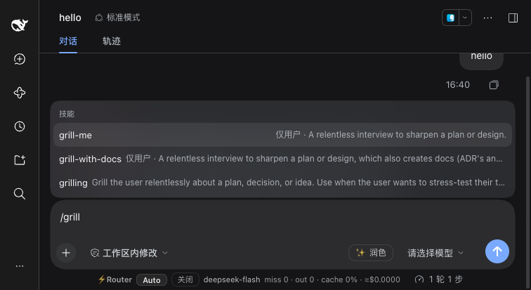

# dsh-engineering-skills

[Matt Pocock's skills](https://github.com/mattpocock/skills) — 27 engineering and
productivity agent skills (grilling, spec/ticket flows, TDD, code review, domain
modelling, handoff, …) — packaged as a **DeepSeek Harness plugin bundle**: one
`dsh plugin add` and all 27 show up in the session skill catalog and the `/` menu;
removing the plugin removes them cleanly.

> The harness is in developer preview and iterates quickly — expect compatibility-breaking changes.

> 中文说明见 [README.zh.md](README.zh.md).

## Screenshots

Skill suggestions in the `/` menu: `grill-me` and `grill-with-docs` carry the
user-only marker (the model can never auto-invoke them), while `grilling` is
model-invoked (it is also in the model's catalog):



## Why a plugin at all

You do **not** need this plugin to use the skills: DSH's filesystem provider scans
`~/.agents/skills` (rank 500) and `<project>/.agents/skills` (rank 200) by default,
and upstream's installer drops the same `SKILL.md` trees there — the format,
frontmatter and `disable-model-invocation` semantics are already identical.

The plugin adds: one-command install/uninstall managed by the profile, versioned
updates pinned to an upstream commit (`UPSTREAM.json`, `sync --check`), no writes
to the shared `~/.agents/skills`, category/name filtering to keep the catalog
prompt small, and a short DSH tool-mapping note appended on load.

## Install

### Prerequisites

The `dsh` CLI must be on your `PATH` (`npm install -g @deepseek-ai/dsh`, or prefix
commands with `npx @deepseek-ai/dsh`). This release is verified on harness `0.2.1-rc.2`.

### Add the bundle

```sh
# 1. add the bundle to your web profile (pnpm-backed; the built lib/ is committed,
#    so no build script runs at install time). Prefer a release tag (#v0.1.2);
#    #main tracks the latest commit.
dsh plugin --profile web add "github:tianji-qingtian/dsh-engineering-skills#v0.1.2"

# 2. restart the harness with that profile — `add` only edits the profile files;
#    a running instance does not hot-load the new bundle
dsh --profile web
```

After the restart the `/` menu lists all 27 skills (16 user-only + 11 dual-channel)
and the model catalog carries the 11 model-invoked ones; `dsh-engineering-skills` appears under
Settings → Plugins.

Local path for development:

```sh
dsh plugin --profile web add <local-checkout>/dsh-engineering-skills
```

## Config

```yaml
- id: engineering-skills
  config:
    categories: [productivity]          # engineering | productivity (default: both)
    skills: [grilling, grill-me, tdd]   # explicit subset; overrides categories
    appendHarnessGuide: true            # append the DSH tool-mapping note on load
    providerName: engineering-skills    # registry provider name
```

A non-empty `skills` list overrides `categories` entirely; unknown categories or
skill names fail the mount instead of silently shrinking the catalog.

## Mapping (upstream → DSH)

| Upstream | DSH |
|---|---|
| `SKILL.md` bundle + YAML frontmatter | same format, parsed by the skill registry |
| `disable-model-invocation: true` (16 skills) | `{ modelInvocable: false, userInvocable: true }` — `/` menu only, never in the catalog or `skill` tool |
| default (11 model-invoked) | `{ modelInvocable: true, userInvocable: true }` — catalog + `skill` tool + `/name` |
| `/name` slash command | `/name` gesture, host injects the same `<skill_content>` block; no commands needed |
| `agents/openai.yaml` | dropped (Codex UI metadata, unread by DSH) |
| referenced sub-files (25) | `resourceBase: { kind: 'directory' }`; the `skill` result carries the base directory |
| `Skill tool` wording | rewritten by the sync script to `` `skill` tool `` |

## Syncing upstream

```sh
node scripts/sync-upstream.mjs                  # re-fetch the pinned commit and rebuild skills/
node scripts/sync-upstream.mjs --source ../mp-skills   # use an existing clone
node scripts/sync-upstream.mjs --check          # CI drift gate
```

Both modes also verify that `UPSTREAM.json` `version` matches the version declared by
the fetched upstream commit (`package.json` / `.claude-plugin/plugin.json`), so a stale
version string cannot pass `--check` by being copied into the manifest.

Release flow: bump `UPSTREAM.json` → sync → `pnpm test` → tag. Only skills listed
in upstream's `.claude-plugin/plugin.json` ship; `in-progress/` and `misc/` never do.

## Known limits

- **`ask-matt` needs a rewrite**: it promises to read other *user-invoked* skills'
  bodies, which DSH deliberately never exposes to the model. Recast it as
  human-facing navigation ("run `/x` yourself").
- **`implement-spec` worktrees**: no first-party worktree tool; the skill must
  drive `git worktree` itself or run serially.
- **`triage` / `wayfinder` / `to-*` need an issue tracker**: prefer the setup
  skill's Local-markdown mode (`.scratch/`) where `gh`/`glab` are unavailable.
- **`improve-codebase-architecture`** report relies on CDN Tailwind/Mermaid;
  prefer self-contained HTML offline.
- **Temp/output**: OS temp and `open` become workspace paths + `present`.
- **Catalog cost**: 11 model-invoked descriptions are resident each request; trim
  with `categories`.
- **English bodies**: add a language line to the project's `AGENTS.md` for Chinese
  output.
- **Harness upgrades**: bump the `@deepseek-ai/dsh-skill` peer range with each
  runtime prerelease and re-run `pnpm test`.

## Harness compatibility

Only `@deepseek-ai/dsh-skill` is gated as a peer (checked at install and at
profile startup; an out-of-range bundle is skipped with `skipping profile bundle …`,
i.e. the plugin silently disappears after a harness upgrade). Prerelease semver
needs an explicit match: `^0.2.1-rc.2` covers `0.2.1-rc.2` and later `0.2.x`
releases but not a new prerelease such as `0.2.2-rc.1`, so bump the peer range on
each harness prerelease and re-run `pnpm test`. No build step is involved: `lib/`
is runnable ESM and `skills/` is data.

## Development

Managed with pnpm `11.28.5` (`packageManager` field; CI pins the same version). Other
major pnpm versions may rewrite `pnpm-lock.yaml`; check the lockfile diff before committing.
The contract baseline is [REQUIREMENTS.md](REQUIREMENTS.md) — change it first when a
service, field or config semantic moves.

```sh
pnpm install
pnpm test                 # 23 assertions + real registry/lifecycle + bundle/package contract
pnpm run sync:check       # upstream drift + pin-version gate
```

`test-package.mjs` checks the `cordis.patch.yml` insert row, the npm `files` whitelist,
manifest-vs-tree consistency and the peer/license files; CI additionally unpacks the
packed tarball and imports it, so the published artifact is exercised, not just the repo.

## License

Plugin code MIT (`LICENSE`); `skills/` is MIT content from Matt Pocock (full text in
`LICENSE-upstream`) — see `NOTICE` and `UPSTREAM.json` for attribution, the exact
rewrite list and the pinned source.
